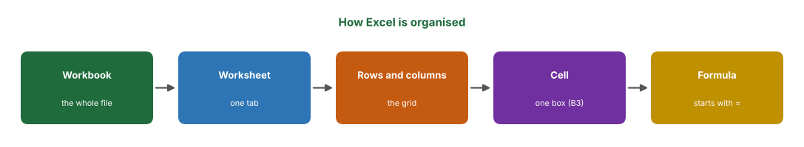
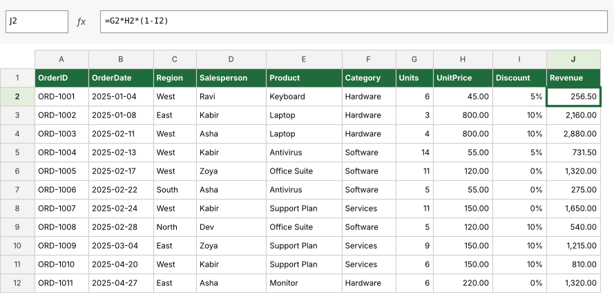
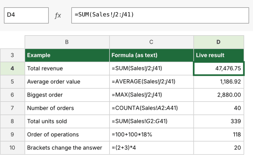

# 01 · Excel Basics and Interface

> Learn the Excel window, workbooks, worksheets, cells and your very first formulas.

| | |
|---|---|
| **Level** | 🟢 Beginner |
| **Best for** | Students · Beginners · Managers · CEOs |
| **Excel version** | Excel 2016 or later |
| **Time to complete** | 45–60 minutes |
| **Prerequisite** | None |
| **Files** | [Notes](README.md) · [Practice workbook](practice_workbook.xlsx) · [Exercises and solutions](exercises_and_solutions.md) |



## 🎯 Objective & Business Use Case

Almost every office job touches a spreadsheet. A sales manager checks targets, an HR officer tracks leave, a founder watches cash. If you can move fast in Excel, open a file, read it, and total a column without fear, you save hours every week and you look reliable. This lesson gives you the base that every later lesson stands on.

**By the end of this module you will be able to:**

- Meet the Excel window
- Move around and select cells
- Type, edit and delete
- Write your first formula
- Copy with the fill handle and AutoSum
- Rows, columns, sheets and saving

## 📖 Core Concepts, Syntax & Jargon Buster

> **New words in this lesson**
>
> - **Workbook**: the Excel file itself (like a ring binder).
> - **Worksheet**: one tab inside the workbook (like one page in the binder).
> - **Cell**: one box on the grid. Its address is the column letter plus the row number, for example B3.
> - **Range**: a group of cells, written with a colon, for example A1:C5.
> - **Ribbon**: the strip of tabs and buttons at the top (Home, Insert, Formulas and so on).
> - **Formula bar**: the long box above the grid that shows what is really inside the active cell.
> - **Active cell**: the cell with the thick green border. What you type goes here.
> - **Fill handle**: the small square at the bottom-right corner of the active cell. Drag it to copy.

## 🪜 Step-by-Step Practical Walkthrough



_The Sales practice sheet. Cell J2 holds a formula; the formula bar shows it._

### Step 1. Meet the Excel window

Think of a **workbook** as a ring binder. Each **worksheet** is a page in it, and each page is a giant grid of **cells**. At the top you have the **Ribbon** (buttons), the **Name Box** (shows the address of the active cell) and the **Formula bar** (shows what is inside it). At the bottom are the **sheet tabs** and the **status bar**, which shows live sums of whatever you select.

### Step 2. Move around and select cells

Click a cell to select it. Drag to select a range. Use the arrow keys to move one cell, and `Ctrl + Arrow` to jump to the edge of your data (like skipping to the last page of a binder). `Ctrl + A` selects everything. Hold `Ctrl` and click to select cells that are not next to each other.



### Step 3. Type, edit and delete

Click a cell and type. Press `Enter` to go down, `Tab` to go right, `Esc` to cancel. Press `F2` to edit what is already in a cell. Pressing `Delete` clears the content but keeps the formatting. Be careful: typing over a cell replaces it.

### Step 4. Write your first formula

Every formula starts with `=`. Excel follows school maths order: brackets first, then powers, then multiply and divide, then add and subtract. So `=2+3*4` gives 14, but `=(2+3)*4` gives 20. Use cell addresses instead of numbers (`=B2*C2`) so the answer updates when the data changes.

### Step 5. Copy with the fill handle and AutoSum

Drag the fill handle down to copy a formula to the rows below. Excel adjusts the addresses for you. To add a column fast, select the cell under it and press `Alt + =` (AutoSum). Excel guesses the range and writes `=SUM(...)`.

### Step 6. Rows, columns, sheets and saving

Right-click a row number or column letter to insert, delete, hide or resize. Double-click the edge of a column header to auto-fit its width. Right-click a sheet tab to rename, colour or copy a sheet. Save with `Ctrl + S`. Use `.xlsx` for normal files, `.xlsm` if the file has macros, and `.csv` for plain text data.

## 🧪 Real-World Scenarios & Worked Examples

All examples use the fictional data in [practice_workbook.xlsx](practice_workbook.xlsx). The sheet name and cell are shown so you can find each one.

### Example 1. Total revenue

**Scenario:** A manager wants the total revenue of all orders.

```excel
=SUM(Sales!$J$2:$J$41)
```
**Result:** `47,476.75`  
**What happened:** SUM adds every number in column J (Revenue) for rows 2 to 41.  
_Find it in sheet `Demo`, cell `D4`._

### Example 2. Average order value

**Scenario:** What does a typical order bring in?

```excel
=AVERAGE(Sales!$J$2:$J$41)
```
**Result:** `1,186.9188`  
**What happened:** AVERAGE adds the numbers and divides by how many there are.  
_Find it in sheet `Demo`, cell `D5`._

### Example 3. Biggest order

**Scenario:** Which single order was the largest?

```excel
=MAX(Sales!$J$2:$J$41)
```
**Result:** `2880`  
**What happened:** MAX returns the largest number in the range.  
_Find it in sheet `Demo`, cell `D6`._

### Example 4. Number of orders

**Scenario:** How many orders are on the sheet?

```excel
=COUNTA(Sales!$A$2:$A$41)
```
**Result:** `40`  
**What happened:** COUNTA counts cells that are not empty. Order IDs are text, so COUNT would give 0 here.  
_Find it in sheet `Demo`, cell `D7`._

### Example 5. Total units sold

**Scenario:** How many items did we ship?

```excel
=SUM(Sales!$G$2:$G$41)
```
**Result:** `339`  
**What happened:** Same SUM, different column (G is Units).  
_Find it in sheet `Demo`, cell `D8`._

### Example 6. Order of operations

**Scenario:** A price of 100 plus 18% tax.

```excel
=100+100*18%
```
**Result:** `118`  
**What happened:** Percent and multiply happen before the plus, so Excel adds 100 and 18.  
_Find it in sheet `Demo`, cell `D9`._

### Example 7. Brackets change the answer

**Scenario:** Add 2 and 3 first, then multiply by 4.

```excel
=(2+3)*4
```
**Result:** `20`  
**What happened:** Brackets are calculated first, so the answer is 20, not 14.  
_Find it in sheet `Demo`, cell `D10`._

## ⚠️ Common Pitfalls & Performance Tips

- Typing numbers inside formulas (`=B2*0.18`) when the rate should live in its own cell. Change the rate once and nothing updates.
- Forgetting the `=` sign. Excel then stores `SUM(A1:A5)` as plain text.
- Typing numbers with spaces or letters (like `1 200` or `5kg`). Excel treats them as text and SUM ignores them.
- Merging cells for layout. It breaks sorting and filtering later. Use Center Across Selection instead.
- Saving over the original file with no backup. Use `Save As` or turn on AutoSave when the file is in OneDrive.

### 💡 Pro Tips

- Select a column of numbers and look at the status bar: you instantly see Sum, Average and Count with no formula.
- `Ctrl + Z` undoes, `Ctrl + Y` redoes. Use them without fear while you learn.
- Press `Ctrl + Home` to jump to A1 and `Ctrl + End` to jump to the last used cell.
- Freeze the top row (View, Freeze Panes) so headings stay visible when you scroll.
- Keep one idea per sheet and name the tabs clearly (Data, Summary, Notes).

## 🧰 Excel Version & Compatibility

**Minimum:** Excel 2016 or later

| Excel 2016 | Excel 2019 | Excel 2021 | Excel 2024 | Microsoft 365 |
|---|---|---|---|---|
| ✅ | ✅ | ✅ | ✅ | ✅ |

## 🎤 Interview Questions with Solutions

<details>
<summary><b>Q1. What is the difference between a workbook and a worksheet?</b></summary>

A workbook is the whole Excel file. A worksheet is one tab (page) inside it. One workbook can hold many worksheets.

</details>

<details>
<summary><b>Q2. What is a cell reference?</b></summary>

The address of a cell: column letter plus row number, like C7. Formulas use it so results update when the data changes.

</details>

<details>
<summary><b>Q3. Why use cell references instead of typing numbers in a formula?</b></summary>

The formula stays correct when inputs change, you can copy it down, and other people can see where numbers come from.

</details>

<details>
<summary><b>Q4. What does `=2+3*4` return and why?</b></summary>

14. Excel multiplies before it adds, the same as normal maths. Brackets change the order.

</details>

<details>
<summary><b>Q5. How do you quickly total a column?</b></summary>

Select the cell below the numbers and press Alt + = (AutoSum), or type =SUM(range). You can also select the numbers and read the total on the status bar.

</details>

## 🏋️ Practice Exercises with Solutions

- Do the exercises: [exercises_and_solutions.md](exercises_and_solutions.md)
- Open the workbook: [practice_workbook.xlsx](practice_workbook.xlsx) (sheets: ReadMe, Sales, Demo, Exercises, Solutions)

---
[📚 Course index](../README.md) · [🧠 Interview questions](../INTERVIEW_QUESTIONS.md) · [⚡ Cheat sheet](../CHEATSHEET.md)
