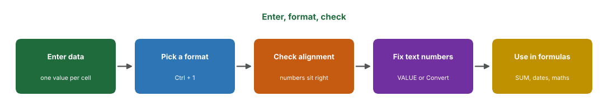
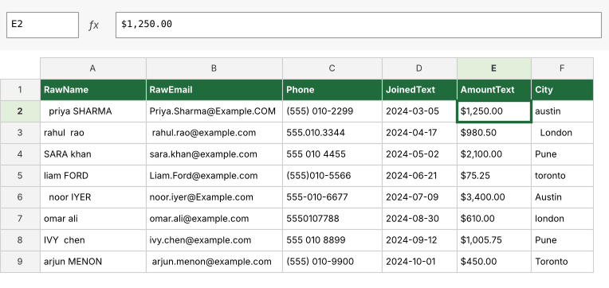
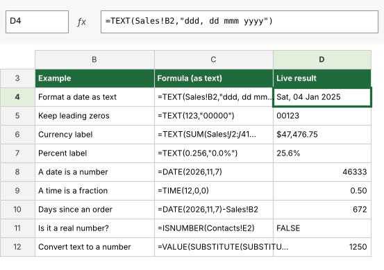

# 02 · Data Entry and Number Formats

> Type data the right way and show it the right way: numbers, dates, currency, percentages and text.

| | |
|---|---|
| **Level** | 🟢 Beginner |
| **Best for** | Students · Beginners · Finance · Researchers · Managers |
| **Excel version** | Excel 2016 or later |
| **Time to complete** | 45–60 minutes |
| **Prerequisite** | Module 01 (recommended) |
| **Files** | [Notes](README.md) · [Practice workbook](practice_workbook.xlsx) · [Exercises and solutions](exercises_and_solutions.md) |



## 🎯 Objective & Business Use Case

Wrong data types cause more broken reports than wrong formulas. A date typed as text will not sort. An amount stored as text will not add up. A phone number that loses its leading zero cannot be used. People who enter data cleanly and format it correctly spend less time fixing files and their numbers can be trusted.

**By the end of this module you will be able to:**

- Know the four data types
- Enter data in a clean layout
- Format numbers (format is a price tag, not the price)
- Dates and times are numbers in disguise
- Custom formats and the TEXT function
- Fix numbers that are stored as text

## 📖 Core Concepts, Syntax & Jargon Buster

> **New words in this lesson**
>
> - **Data type**: the kind of value in a cell: number, text, date/time or TRUE/FALSE.
> - **Number format**: a rule that changes how a value is shown without changing the value stored.
> - **Serial number**: how Excel stores a date: a whole number that counts days. A time is stored as a fraction of a day.
> - **General format**: the default format. Excel guesses what to show.
> - **Custom format**: a format you write yourself, such as 00000 or #,##0.0.
> - **Autofill**: dragging the fill handle to continue a pattern like Mon, Tue, Wed or 1, 2, 3.
> - **Flash Fill**: Excel spots your pattern from an example and fills the rest (Ctrl + E).

## 🪜 Step-by-Step Practical Walkthrough



_Messy sample data. The amounts and dates are text, so they sit on the left._

### Step 1. Know the four data types

Excel cells hold **numbers**, **text**, **dates and times**, and **logical values** (TRUE or FALSE). A quick clue: numbers line up on the right of the cell and text lines up on the left. If your numbers are hugging the left side, they are probably text.

### Step 2. Enter data in a clean layout

Use one header row, one value per cell, and no blank rows or columns inside the table. Think of it as a neat register book, not a poster. Use Autofill for series (days, months, 1-2-3). Try Flash Fill: type the first result by hand, then press `Ctrl + E` and Excel fills the rest.



### Step 3. Format numbers (format is a price tag, not the price)

Select cells and press `Ctrl + 1` (Format Cells). A format only changes what you **see**. If a cell holds 2.456 and is formatted to show one decimal (2.5), the real value is still 2.456 and formulas use 2.456. Handy shortcuts on Windows: `Ctrl + Shift + $` currency, `Ctrl + Shift + %` percent, `Ctrl + Shift + #` date, `Ctrl + Shift + !` number with two decimals, `Ctrl + Shift + ~` back to General.

### Step 4. Dates and times are numbers in disguise

Excel counts days. Because dates are numbers you can add 30 days to an order date or subtract two dates to get the gap in days. Time is a fraction of a day, so 12:00 noon is 0.5. If a date shows as a number like 46333, just apply a date format.

### Step 5. Custom formats and the TEXT function

A custom format such as `00000` keeps leading zeros (7 shows as 00007) and `#,##0,"K"` shows thousands as K. The TEXT function does the same inside a formula, but the result is **text**, so use it only for display, not for further maths.

### Step 6. Fix numbers that are stored as text

Signs: a green triangle in the corner, left-aligned numbers, SUM ignoring them. Fixes: choose Convert to Number from the warning icon, use Data, Text to Columns, or use `VALUE`. For messy symbols (such as $ or commas) clean the text with SUBSTITUTE first, then wrap with VALUE.

## 🧪 Real-World Scenarios & Worked Examples

All examples use the fictional data in [practice_workbook.xlsx](practice_workbook.xlsx). The sheet name and cell are shown so you can find each one.

### Example 1. Format a date as text

**Scenario:** Show the first order date as a friendly label.

```excel
=TEXT(Sales!B2,"ddd, dd mmm yyyy")
```
**Result:** `Sat, 04 Jan 2025`  
**What happened:** TEXT turns the date serial number into text using the pattern you give.  
_Find it in sheet `Demo`, cell `D4`._

### Example 2. Keep leading zeros

**Scenario:** A product code 123 must show as five digits.

```excel
=TEXT(123,"00000")
```
**Result:** `00123`  
**What happened:** Each 0 in the format forces a digit, so Excel pads with zeros.  
_Find it in sheet `Demo`, cell `D5`._

### Example 3. Currency label

**Scenario:** Show total revenue as a dollar amount in a report title.

```excel
=TEXT(SUM(Sales!$J$2:$J$41),"$#,##0.00")
```
**Result:** `$47,476.75`  
**What happened:** SUM adds the revenue. TEXT then adds the dollar sign, thousands comma and two decimals.  
_Find it in sheet `Demo`, cell `D6`._

### Example 4. Percent label

**Scenario:** Show 0.256 as a percentage with one decimal.

```excel
=TEXT(0.256,"0.0%")
```
**Result:** `25.6%`  
**What happened:** The percent sign in the format multiplies by 100 for display.  
_Find it in sheet `Demo`, cell `D7`._

### Example 5. A date is a number

**Scenario:** Show the serial number behind 7 November 2026.

```excel
=DATE(2026,11,7)
```
**Result:** `46333`  
**What happened:** The cell is formatted as a plain number (0) so you see the serial number Excel stores.  
_Find it in sheet `Demo`, cell `D8`._

### Example 6. A time is a fraction

**Scenario:** Noon is half a day.

```excel
=TIME(12,0,0)
```
**Result:** `0.5`  
**What happened:** TIME returns the fraction of the day, 0.5 for 12:00.  
_Find it in sheet `Demo`, cell `D9`._

### Example 7. Days since an order

**Scenario:** How many days passed between the first order and 7 November 2026?

```excel
=DATE(2026,11,7)-Sales!B2
```
**Result:** `672`  
**What happened:** Subtracting two dates gives the number of days between them.  
_Find it in sheet `Demo`, cell `D10`._

### Example 8. Is it a real number?

**Scenario:** Contacts!E2 holds the text $1,250.00. Is Excel treating it as a number?

```excel
=ISNUMBER(Contacts!E2)
```
**Result:** `FALSE`  
**What happened:** FALSE means it is text, so SUM would ignore it.  
_Find it in sheet `Demo`, cell `D11`._

### Example 9. Convert text to a number

**Scenario:** Strip the dollar sign and comma, then convert.

```excel
=VALUE(SUBSTITUTE(SUBSTITUTE(Contacts!E2,"$",""),",",""))
```
**Result:** `1250`  
**What happened:** SUBSTITUTE removes the symbols and VALUE converts the clean text to a real number.  
_Find it in sheet `Demo`, cell `D12`._

## ⚠️ Common Pitfalls & Performance Tips

- Typing a date like `5.3.24` or `5th March`. Excel may keep it as text. Use a clear pattern such as 2024-03-05.
- Using TEXT in a column you want to add up. TEXT returns text, so SUM ignores it.
- Rounding by changing the format. The format only hides decimals. Use ROUND when the value itself must change.
- Typing leading zeros into General cells. Excel drops them. Format the cells as Text or use a custom format first.
- Mixing date styles (day-first and month-first) in one column. Excel may read `03/04/2024` differently on different computers.

### 💡 Pro Tips

- A date or number that lines up on the left side of the cell is a warning sign. Fix it before you build formulas on it.
- Use ISO dates (yyyy-mm-dd). They read the same in every country.
- Use the Accounting or Currency format for money and the Percentage format for rates. Type 5 in a Percentage cell and Excel shows 5%.
- Press `Ctrl + ;` to enter today's date as a fixed value and `Ctrl + Shift + ;` for the current time.
- Select any cell and look at the Number Format box on the Home tab. It tells you how Excel reads the cell.

## 🧰 Excel Version & Compatibility

**Minimum:** Excel 2016 or later

| Excel 2016 | Excel 2019 | Excel 2021 | Excel 2024 | Microsoft 365 |
|---|---|---|---|---|
| ✅ | ✅ | ✅ | ✅ | ✅ |

## 🎤 Interview Questions with Solutions

<details>
<summary><b>Q1. What is the difference between a cell's value and its displayed text?</b></summary>

The value is what Excel stores and uses in formulas. The displayed text is what the number format shows. For example 2.456 can display as 2.5 but formulas still use 2.456.

</details>

<details>
<summary><b>Q2. How does Excel store dates?</b></summary>

As serial numbers that count days from a start date. That is why you can add and subtract dates. Times are fractions of a day.

</details>

<details>
<summary><b>Q3. Your numbers will not add up and they sit on the left of the cells. What is wrong?</b></summary>

They are stored as text. Convert them with Convert to Number, Text to Columns or VALUE, then SUM works.

</details>

<details>
<summary><b>Q4. When would you use the TEXT function?</b></summary>

When you need a number or date as a formatted label, for example in a report title or a joined sentence. Do not use it when you still need to calculate with the result.

</details>

<details>
<summary><b>Q5. How do you keep a leading zero in a code like 00123?</b></summary>

Format the cells as Text before typing, use a custom format 00000, or use TEXT(value,"00000") in a formula.

</details>

## 🏋️ Practice Exercises with Solutions

- Do the exercises: [exercises_and_solutions.md](exercises_and_solutions.md)
- Open the workbook: [practice_workbook.xlsx](practice_workbook.xlsx) (sheets: ReadMe, Sales, Contacts, Demo, Exercises, Solutions)

---
[📚 Course index](../README.md) · [🧠 Interview questions](../INTERVIEW_QUESTIONS.md) · [⚡ Cheat sheet](../CHEATSHEET.md)
