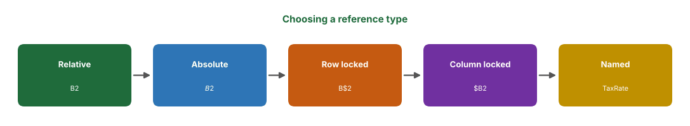
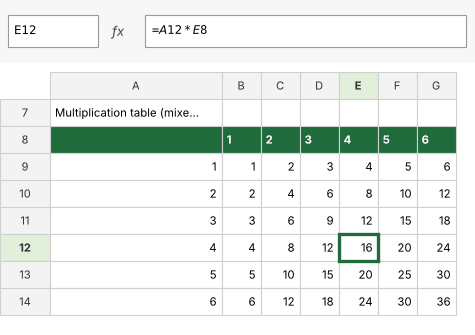
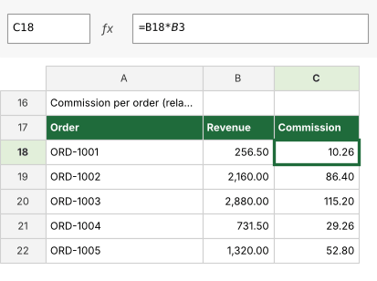

# 03 · Formulas and Cell References

> Learn how formulas work and the difference between relative, absolute and mixed references and named ranges.

| | |
|---|---|
| **Level** | 🟢 Beginner |
| **Best for** | Students · Analysts · Finance · Managers |
| **Excel version** | Excel 2016 or later |
| **Time to complete** | 45–60 minutes |
| **Prerequisite** | Module 02 (recommended) |
| **Files** | [Notes](README.md) · [Practice workbook](practice_workbook.xlsx) · [Exercises and solutions](exercises_and_solutions.md) |



## 🎯 Objective & Business Use Case

A formula that copies correctly is the difference between one minute of work and one hour. Finance teams lock the tax-rate cell, sales teams copy one commission formula down thousands of rows, and managers read named ranges like `TaxRate` instead of guessing what `$B$4` means. Reference mistakes are also the most common hidden error in real workbooks.

**By the end of this module you will be able to:**

- Formulas are instructions, references are addresses
- Relative references move when copied
- Absolute references stay put
- Mixed references lock one direction
- Name your important cells
- Read and audit formulas

## 📖 Core Concepts, Syntax & Jargon Buster

> **New words in this lesson**
>
> - **Formula**: an instruction that starts with = and tells Excel to calculate something.
> - **Cell reference**: the address of a cell used inside a formula, such as B2.
> - **Relative reference**: a reference that shifts when you copy the formula (B2 becomes B3 one row down).
> - **Absolute reference**: a reference locked with dollar signs ($B$3) that never moves when copied.
> - **Mixed reference**: only the row or only the column is locked, such as $A9 or B$8.
> - **Named range**: a cell or range with a friendly name, such as TaxRate, that you can use in formulas.
> - **Operator**: a symbol that does a job in a formula: + - * / ^ & = < > <= >= <>.

## 🪜 Step-by-Step Practical Walkthrough



_The cell E12 holds =$A12*E$8._

### Step 1. Formulas are instructions, references are addresses

A formula is like a recipe card: it says what to do and which ingredients (cells) to use. `=B2*C2` means "take what is in B2, multiply by what is in C2". Because it points to addresses, the answer updates whenever the ingredients change.

### Step 2. Relative references move when copied

Imagine telling someone "take the box one step to your left". Wherever they stand, they take the box one step left. A relative reference works the same way. `=B18*$B$3` in row 18 becomes `=B19*$B$3` in row 19. Drag the fill handle and the formula adapts.



### Step 3. Absolute references stay put

Sometimes you want a fixed address, like "the box on shelf 3, no matter where you stand". Add dollar signs to lock it: `$B$3`. Press `F4` while the cursor is inside a reference to cycle through $B$3, B$3, $B3 and B3. Use this for tax rates, exchange rates and targets.

### Step 4. Mixed references lock one direction

`$A9` locks the column but lets the row move. `B$8` locks the row but lets the column move. Together `=$A9*B$8` builds a whole multiplication table from one formula. This is the secret behind many price grids and what-if tables.

### Step 5. Name your important cells

Select a cell or range, type a name in the Name Box (left of the formula bar) and press Enter, or use Formulas, Define Name. Then write `=SUM(Revenue)` or `=Revenue*TaxRate`. Names make formulas easier to read and they never need dollar signs. Press `Ctrl + F3` to open the Name Manager.

### Step 6. Read and audit formulas

Press `Ctrl + `` ` `` (the key left of 1) to show every formula on the sheet. Use `F2` to see the colour-coded cells a formula points to. Use Formulas, Trace Precedents to draw arrows. The FORMULATEXT function shows another cell's formula as text.

## 🧪 Real-World Scenarios & Worked Examples

All examples use the fictional data in [practice_workbook.xlsx](practice_workbook.xlsx). The sheet name and cell are shown so you can find each one.

### Example 1. Relative plus absolute

**Scenario:** The commission for the first order in the Refs sheet (row 18).

```excel
=Refs!B18*Refs!$B$3
```
**Result:** `10.26`  
**What happened:** B18 is relative (moves down when copied). $B$3 is the locked commission rate.  
_Find it in sheet `Demo`, cell `D4`._

### Example 2. Mixed reference

**Scenario:** Read the multiplication table cell E12 (4 times 4).

```excel
=Refs!$A12*Refs!E$8
```
**Result:** `16`  
**What happened:** The column of A is locked and the row of 8 is locked. That is how the whole table is built from one formula.  
_Find it in sheet `Demo`, cell `D5`._

### Example 3. Named range total

**Scenario:** Total revenue using the name Revenue instead of Sales!$J$2:$J$41.

```excel
=SUM(Revenue)
```
**Result:** `47,476.75`  
**What happened:** A named range reads like a word. The name points to Sales!J2:J41.  
_Find it in sheet `Demo`, cell `D6`._

### Example 4. Named input

**Scenario:** Tax on total revenue at the rate stored in the name TaxRate (18%).

```excel
=SUM(Revenue)*TaxRate
```
**Result:** `8,545.815`  
**What happened:** Change Refs!B4 and the answer changes. No number is hidden inside the formula.  
_Find it in sheet `Demo`, cell `D7`._

### Example 5. Names in SUMIF

**Scenario:** Total revenue of the North region using two names.

```excel
=SUMIF(Region,"North",Revenue)
```
**Result:** `7974`  
**What happened:** SUMIF checks every cell in Region and adds the matching cells of Revenue.  
_Find it in sheet `Demo`, cell `D8`._

### Example 6. Link to another sheet

**Scenario:** Pull the revenue of the first order onto another sheet.

```excel
=Sales!J2
```
**Result:** `256.5`  
**What happened:** A sheet name, an exclamation mark and a cell address point to another sheet.  
_Find it in sheet `Demo`, cell `D9`._

### Example 7. Show a formula as text

**Scenario:** Read the formula stored in Refs!C18.

```excel
=FORMULATEXT(Refs!C18)
```
**Result:** `=B18*$B$3`  
**What happened:** FORMULATEXT lets you document formulas in plain view.  
_Find it in sheet `Demo`, cell `D10`._

## ⚠️ Common Pitfalls & Performance Tips

- Forgetting to lock the rate cell (`B3` instead of `$B$3`). The first row is right and the rest quietly point at empty cells.
- Locking too much. A table built with `$A$9*$B$8` gives the same number everywhere.
- Typing a name with spaces or a name that looks like a cell (such as `Q1` or `TAX1`). Use letters and underscores, like `Tax_Rate`.
- Hard-coding numbers in formulas (`=B2*0.18`). Nobody knows where 0.18 came from.
- Deleting a row that a formula points to. The formula shows #REF!.

### 💡 Pro Tips

- Press `F4` right after typing a cell address to add dollar signs fast.
- Put all inputs (rates, targets, dates) in one clearly labelled block and give them names.
- Colour inputs blue and formulas black. Anyone can see what to change.
- Use `Ctrl + Shift + F3` to create names from your row and column headings in one step.
- Before copying a formula to 1,000 rows, test it on two rows and check the second row's formula with `F2`.

## 🧰 Excel Version & Compatibility

**Minimum:** Excel 2016 or later

| Excel 2016 | Excel 2019 | Excel 2021 | Excel 2024 | Microsoft 365 |
|---|---|---|---|---|
| ✅ | ✅ | ✅ | ✅ | ✅ |

## 🎤 Interview Questions with Solutions

<details>
<summary><b>Q1. What is the difference between a relative and an absolute reference?</b></summary>

A relative reference changes when you copy the formula. An absolute reference ($B$3) is locked and always points to the same cell.

</details>

<details>
<summary><b>Q2. What does the F4 key do while editing a formula?</b></summary>

It cycles the reference through $A$1, A$1, $A1 and A1 so you can lock the row, the column, both or neither.

</details>

<details>
<summary><b>Q3. When would you use a mixed reference?</b></summary>

When a formula must be copied in two directions, such as a price grid or multiplication table where one input lives in a left column and the other in a top row.

</details>

<details>
<summary><b>Q4. What are the benefits of named ranges?</b></summary>

Formulas are easier to read (=Revenue*TaxRate), names do not shift when copied, and one change to the name updates every formula that uses it.

</details>

<details>
<summary><b>Q5. A formula you copied down shows the same result in every row. What is the likely cause?</b></summary>

A reference that should be relative was locked with dollar signs, or the calculation mode is set to manual.

</details>

## 🏋️ Practice Exercises with Solutions

- Do the exercises: [exercises_and_solutions.md](exercises_and_solutions.md)
- Open the workbook: [practice_workbook.xlsx](practice_workbook.xlsx) (sheets: ReadMe, Sales, Refs, Demo, Exercises, Solutions)

---
[📚 Course index](../README.md) · [🧠 Interview questions](../INTERVIEW_QUESTIONS.md) · [⚡ Cheat sheet](../CHEATSHEET.md)
