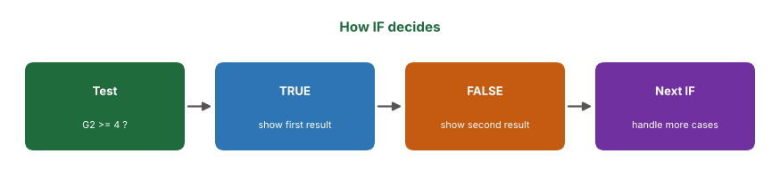
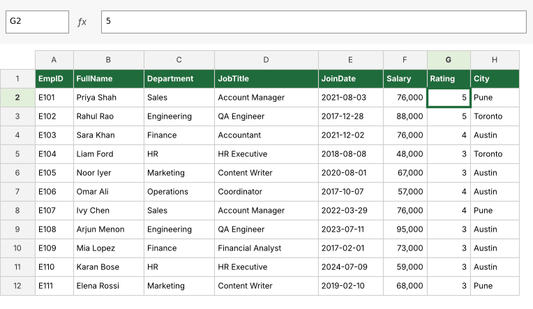
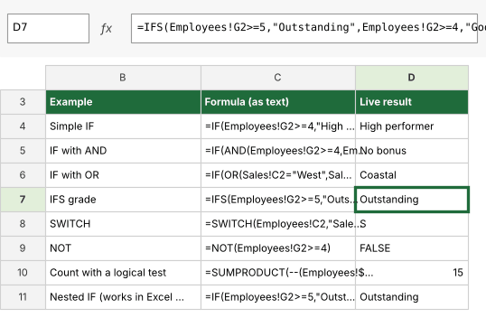

# 04 · Logical Functions: IF, IFS, AND, OR, NOT and SWITCH

> Teach Excel to make decisions with IF, IFS, AND, OR, NOT and SWITCH.

| | |
|---|---|
| **Level** | 🟢 Beginner |
| **Best for** | Students · Analysts · Finance · HR · Managers |
| **Excel version** | Excel 2019 or later |
| **Time to complete** | 45–60 minutes |
| **Prerequisite** | Module 03 (recommended) |
| **Files** | [Notes](README.md) · [Practice workbook](practice_workbook.xlsx) · [Exercises and solutions](exercises_and_solutions.md) |



## 🎯 Objective & Business Use Case

Business is full of rules. Pay a bonus if the rating is 4 or more. Flag an order as bulk if it has 10 or more units. Label a customer Gold, Silver or Bronze. Logical functions let you write the rule once and apply it to thousands of rows. HR, finance, sales and operations teams use them every day.

**By the end of this module you will be able to:**

- IF asks a yes/no question
- AND, OR and NOT build smarter tests
- IFS handles many outcomes without nesting
- SWITCH matches one value to many answers
- Combine IF with counting and summing
- Keep rules readable

## 📖 Core Concepts, Syntax & Jargon Buster

> **New words in this lesson**
>
> - **Logical test**: a question Excel can answer with TRUE or FALSE, such as G2>=4.
> - **Boolean**: another name for a TRUE/FALSE value.
> - **Comparison operator**: a symbol that compares two values: = < > <= >= <> (not equal).
> - **Nested IF**: an IF placed inside another IF to handle more than two outcomes.
> - **Argument**: one piece of information you give a function, separated by commas.
> - **Default**: the result used when none of the conditions match.

## 🪜 Step-by-Step Practical Walkthrough



_The Employees sheet. The Rating column (G) feeds the logical tests._

### Step 1. IF asks a yes/no question

Think of a traffic light. `=IF(test, result_if_true, result_if_false)` checks the test and shows one of two results. Example: `=IF(G2>=4,"High performer","Needs review")`. Text results go in quotes. Numbers and cell references do not.

### Step 2. AND, OR and NOT build smarter tests

`AND` is TRUE only when **all** parts are TRUE (a door that needs a key and a code). `OR` is TRUE when **any** part is TRUE (a door with two keys). `NOT` flips the answer. You normally place them inside IF: `=IF(AND(G2>=4,F2<70000),"Bonus","No bonus")`.



### Step 3. IFS handles many outcomes without nesting

`=IFS(test1,result1,test2,result2,TRUE,default)` checks the tests in order and returns the first match. Finish with `TRUE` as the catch-all. It is much easier to read than a nest of IFs. Order matters: put the strictest test first.

### Step 4. SWITCH matches one value to many answers

When you compare a single cell against a list of exact values, SWITCH is shorter than IFS: `=SWITCH(C2,"Sales","S","Engineering","E","Finance","F","Other")`. The last argument is the default.

### Step 5. Combine IF with counting and summing

A comparison on a whole range gives a list of TRUE/FALSE. Multiply by 1 (or use `--`) to turn them into 1 and 0, then add them with SUMPRODUCT: `=SUMPRODUCT(--(G2:G25>=4))` counts the high performers with no helper column.

### Step 6. Keep rules readable

Put thresholds in cells (a 'Rules' table) and point to them instead of typing 4 or 70000 inside the formula. Then a manager can change the rule without touching the formula.

## 🧪 Real-World Scenarios & Worked Examples

All examples use the fictional data in [practice_workbook.xlsx](practice_workbook.xlsx). The sheet name and cell are shown so you can find each one.

### Example 1. Simple IF

**Scenario:** Label the first employee by rating.

```excel
=IF(Employees!G2>=4,"High performer","Needs review")
```
**Result:** `High performer`  
**What happened:** The test checks the rating. TRUE shows the first text and FALSE the second.  
_Find it in sheet `Demo`, cell `D4`._

### Example 2. IF with AND

**Scenario:** A bonus needs a rating of 4 or more and a salary under 70,000.

```excel
=IF(AND(Employees!G2>=4,Employees!F2<70000),"Bonus","No bonus")
```
**Result:** `No bonus`  
**What happened:** AND returns TRUE only when both parts are TRUE.  
_Find it in sheet `Demo`, cell `D5`._

### Example 3. IF with OR

**Scenario:** Mark West and East orders as Coastal.

```excel
=IF(OR(Sales!C2="West",Sales!C2="East"),"Coastal","Inland")
```
**Result:** `Coastal`  
**What happened:** OR is TRUE when either region matches.  
_Find it in sheet `Demo`, cell `D6`._

### Example 4. IFS grade

**Scenario:** Turn a rating into a grade.

```excel
=IFS(Employees!G2>=5,"Outstanding",Employees!G2>=4,"Good",Employees!G2>=3,"OK",TRUE,"Low")
```
**Result:** `Outstanding`  
**What happened:** IFS tests from top to bottom. TRUE at the end catches everything else.  
_Find it in sheet `Demo`, cell `D7`._

### Example 5. SWITCH

**Scenario:** Turn a department name into a short code.

```excel
=SWITCH(Employees!C2,"Sales","S","Engineering","E","Finance","F","Other")
```
**Result:** `S`  
**What happened:** SWITCH compares one value with a list of exact matches. The last value is the default.  
_Find it in sheet `Demo`, cell `D8`._

### Example 6. NOT

**Scenario:** Is the first employee NOT a high performer?

```excel
=NOT(Employees!G2>=4)
```
**Result:** `FALSE`  
**What happened:** NOT flips TRUE to FALSE and FALSE to TRUE.  
_Find it in sheet `Demo`, cell `D9`._

### Example 7. Count with a logical test

**Scenario:** How many employees have a rating of 4 or more?

```excel
=SUMPRODUCT(--(Employees!$G$2:$G$25>=4))
```
**Result:** `15`  
**What happened:** The test makes TRUE/FALSE for every row. The double minus turns them into 1 and 0 and SUMPRODUCT adds them.  
_Find it in sheet `Demo`, cell `D10`._

### Example 8. Nested IF (works in Excel 2016)

**Scenario:** The same grade as Example 4 without IFS.

```excel
=IF(Employees!G2>=5,"Outstanding",IF(Employees!G2>=4,"Good",IF(Employees!G2>=3,"OK","Low")))
```
**Result:** `Outstanding`  
**What happened:** Each IF handles one case and passes the rest to the next IF. It works, but gets hard to read quickly.  
_Find it in sheet `Demo`, cell `D11`._

## ⚠️ Common Pitfalls & Performance Tips

- Putting text results without quotes (`=IF(A1>5,High,Low)`). Excel thinks High is a name and returns #NAME?.
- Writing the tests in the wrong order in IFS. `>=3` before `>=5` catches everything.
- Forgetting the final `TRUE` in IFS. If nothing matches, Excel returns #N/A.
- Using `=` to compare numbers stored as text. `"5"=5` is FALSE.
- Nesting more than three or four IFs. Use IFS, SWITCH or a lookup table instead.

### 💡 Pro Tips

- Press `F2` and look at the coloured brackets to check that every IF is closed.
- Use a rules table plus a lookup (see topic 05) when you have more than four outcomes.
- Test logic with a few rows where you already know the answer.
- `<>` means "not equal". `=IF(C2<>"North","Other","North")` is a common pattern.
- Wrap a long formula over several lines with `Alt + Enter` inside the formula bar to make it readable.

## 🧰 Excel Version & Compatibility

**Minimum:** Excel 2019 or later

| Excel 2016 | Excel 2019 | Excel 2021 | Excel 2024 | Microsoft 365 |
|---|---|---|---|---|
| ❌ | ✅ | ✅ | ✅ | ✅ |

IF, AND, OR and NOT work in every version. IFS and SWITCH need Excel 2019 or Microsoft 365. In Excel 2016 use nested IF (Example 8 shows how).

## 🎤 Interview Questions with Solutions

<details>
<summary><b>Q1. What does IF return when the logical test is TRUE?</b></summary>

The second argument (value_if_true). If the test is FALSE it returns the third argument (value_if_false).

</details>

<details>
<summary><b>Q2. What is the difference between AND and OR?</b></summary>

AND needs every condition to be TRUE. OR needs at least one condition to be TRUE.

</details>

<details>
<summary><b>Q3. Why use IFS instead of nested IF?</b></summary>

IFS is easier to read and has less brackets to match. It needs Excel 2019 or 365; in Excel 2016 you must nest IFs.

</details>

<details>
<summary><b>Q4. When is SWITCH better than IFS?</b></summary>

When you compare one value against a list of exact matches, such as department codes. SWITCH repeats the value only once.

</details>

<details>
<summary><b>Q5. How can you count the cells that meet a logical test without a helper column?</b></summary>

Use SUMPRODUCT with a double minus, for example =SUMPRODUCT(--(G2:G25>=4)). COUNTIF also works for simple tests.

</details>

## 🏋️ Practice Exercises with Solutions

- Do the exercises: [exercises_and_solutions.md](exercises_and_solutions.md)
- Open the workbook: [practice_workbook.xlsx](practice_workbook.xlsx) (sheets: ReadMe, Employees, Sales, Demo, Exercises, Solutions)

---
[📚 Course index](../README.md) · [🧠 Interview questions](../INTERVIEW_QUESTIONS.md) · [⚡ Cheat sheet](../CHEATSHEET.md)
